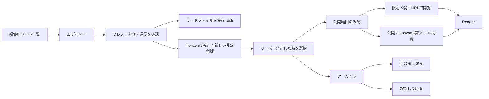

# DSF Studio 全体のUI/UX見直し

2026-10-24。現状調査と設計提案。用語はFlow原稿との区別を踏まえ改訂。**初回レビュー時点の監査。用語・公開状態の共通化とHome縦一覧は、その後ユーザー承認を受けて実装。進捗は実装計画と検証記録を参照**。

実装順・完了条件は [実装計画](studio-ui-ux-implementation-plan.md) を参照。

## 1. 結論

Studioを「編集用リードを作る → プレスで版を発行する → リーズで公開を管理する」という一つの流れに整理する。管理画面は、横方向のカード棚をやめ、見出し付きの縦一覧を基本にする。

YouTube Studioの添付画像から参考にするのは、ナビゲーションの一貫性、列による比較、検索・絞り込み・行操作のまとまり。動画用の横長サムネイルや、未実装の分析・収益化機能は持ち込まない。DSFの表紙は9:16を維持する。

優先する改善は次の順序とする。

1. **対象・状態の正しさ**：「編集用リード」と「発行済みの版」を分け、公開状態の食い違いをなくす。
2. **迷わない導線**：同じ名前の入口は同じ場所へ移動する。編集中のリードを保ったまま各画面を往復できる。
3. **比較しやすい縦一覧**：タイトル、状態、日付、操作の列を揃える。
4. **Studio共通の見た目**：文字・余白・フォーム・サムネイル・明暗テーマを統一する。
5. **用途で伝える文言**：古いDSP表記や内部処理の説明を、利用者が行う操作へ置き換える。

## 2. 調査範囲と根拠

### 今回確認したもの

- stagingのChrome画面：ダッシュボード、左メニューの原稿一覧、復元用コピー、原稿のゴミ箱、スペース設定、リーズ、エディター、原稿設定ダイアログ、プレス、ヘルプ。
- staging表示バージョン：`v2026.10.24-111407`。ダークテーマで確認。ユーザー提供のライトテーマのリーズ画面と、YouTube Studioの参考画像も参照。
- Home／Editor／Press／Worksの画面定義、動的描画、スタイル、日英文言、ファイル名の処理、保存状態の表示、発行済み版の管理仕様。
- 「公開状況・反応」はHomeと共通の集計・描画実装を確認。招待・共有など、機能フラグで変わる入口は実装を確認した。

今回は表示と導線の調査であり、原稿を編集・保存したり、公開状態・設定を変更したりしていない。設定は変更せず閉じ、最後にダッシュボードへ戻した。

### 確認の限界

- 英語表示、モバイル実機、未ログイン、権限失効、オフラインは今回の実画面確認には含まない。設計・実装時の確認条件に含める。
- 共有・招待・課金・アカウント管理の全操作を通した調査ではない。Studio内の入口と既存の権限境界を対象にする。
- 発行・公開・Reader閲覧、アーカイブ・復元・廃棄の全経路が今回再検証済みという意味ではない。以前のHorizon作業の受け入れ確認を引き継ぐ。
- 本文・画像の編集道具は構成と主要導線を確認した。すべての編集機能の操作試験は別途必要。

### 参照する正本

- [ファイル形式](file-format-spec.md)：新規出力 `.dsfp`／`.dsfr`、旧入力の互換性。
- [クラウド保存契約](cloud-save-contract.md)：保存済みの根拠、競合時の保持、原稿と配信の分離。
- [Horizonの版・公開URL・リーズ管理](horizon-editions-spec.md)：版ごとの内容・URL固定、4フォルダ、廃棄、後継版。
- [最近の作業とゴミ箱](studio-recents-trash-plan.md)：原稿の30日復元、復元コピーの分離、検索対象の範囲。
- [画面の責務境界](studio-app-room-boundaries.md)：現在のルーム遷移と副作用。
- `docs/ui-architecture.md` は従来の構成案。現行画面と一致しない部分があるため、今後のStudio管理画面の設計判断は本提案と実装計画に集約する。

## 3. 現状の問題

P0は誤解や誤操作につながる表示、P1は日常操作の負担、P2は細部の整理。以下の位置は調査時点の実装。

| ID | 優先 | 観察した事実 | 改善方針 |
|---|---|---|---|
| A01 | P0 | 左の「リーズ」は編集用原稿、上の「リーズ」は発行済み版を表示する。`home-workspace.js` の `projects` と `works` ルームが別対象 | 前者を「編集用リード」にする。「リーズ」は発行済み版の管理に限定 |
| A02 | P0 | Homeは `dsfPages` がある原稿を発行済みと判定し、原稿の `dsfStatus` を表示する。リーズはReleaseとedition stateを使用する | 発行済み版の状態・数・URLを同じ読み取り元から表示。v2を `dsfPages` の有無で除外しない |
| A03 | P0 | 調査時、Homeは「発行済みリーズ 3」、リーズは4フォルダ合計38件。原稿単位と版単位が同じ名称で混在し、Homeにはテスト版の「下書き」表示も残る | 単位とスペース範囲を揃える。「編集用リード6件」「発行済みの版38件」など別の数として表示。数値自体は固定しない |
| A04 | P1 | 最近の作業は270px幅の横スクロール棚。「前のリード／次のリード」はページ送りではなく横移動。原稿一覧は別のカード配置 | 編集用リード1件を1行で表示する縦一覧に統一。検索、並べ替え、ページ送りの意味を統一 |
| A05 | P1 | Home、復元用コピー、リーズで表紙寸法・角丸・画像なしの扱いが異なる。最近の作業は画像エラーで画像要素を除去する | 9:16・角丸なしの固定枠と共通プレースホルダー。読込中も列幅を維持 |
| A06 | P1 | ダークテーマの最近の作業で入力・選択欄が白く、選択文字が薄い。リーズの操作ボタンも白い | 旧 `--bg-panel` 等とStudio用変数の混在を整理し、フォームとボタンの明暗を共通化 |
| A07 | P1 | 開いている原稿、長い案内、復元入口、横棚、大きな数値カード、発行済みカードが縦に積まれ、一覧の開始位置が下がる | 開いている編集用リードは細い作業バー。概要は短い要約。作業の中心を編集用リード一覧へ移す |
| A08 | P1 | 上部「ダッシュボード」でHomeへ戻ると、直前の「ゴミ箱」が表示された。上部タブの名称と内容が一致しない | 明示的な行き先と、前の一覧に戻る操作を区別。選択中項目を一意にする |
| A09 | P1 | リーズは版名未設定だと同じ題名と発行日時が多数並ぶ。設定・公開状態・プレビュー・URL・アーカイブが各行に常設 | 版名・発行日時を読み取りやすくし、主要操作とその他メニューを分離。題名一致で版を統合しない |
| A10 | P0 | 「プレビュー」は公開状態によって公開URLまたは所有者専用URLを開く。同じボタン名で閲覧条件が違う | 「Readerで開く」と「非公開版を確認」を使い分け、対象版・認証・失敗時の案内を揃える |
| A11 | P1 | プレスに「Press Room」「DSP → DSF」「ZIP」「レンダリング」、開発向け解像度、容量比較の試行が混在する | 通常画面は内容確認・配信用ファイル・発行の言葉で説明。開発用試行は開発向け表示へ |
| A12 | P1 | 原稿設定の長いダイアログに管理名、言語、紹介、表紙、背表紙、本文設定、ライセンス、コピー削除が同居 | リード設定を項目別の画面／パネルに分ける。削除操作は保存・復元の項目へ |
| A13 | P0 | 保存状態・復元案内にも「DSPに保存」が残る。ファイル処理は新しい `.dsfp` に対応済み | 保存契約を変えず、保存先と結果を用途名で説明する |
| A14 | P1 | 原稿検索は取得済み項目を対象にし、未取得分を注記する。全件検索と同じ見た目にすると誤解する | 「取得済みN件を検索」を維持。実装されていない全件検索・総件数を約束しない |
| A15 | P0 | レビュー集計は1作品最大50件、対象作品も最大12件。取得不能時にもカード内数値の一部が0になる | 未取得・取得不能・真の0を分離。現行範囲の数値を総数に見せない |
| A16 | P1 | 原稿のゴミ箱と版のアーカイブは挙動が異なるが、現在は関連する入口が離れている | 対象名を付ける。編集用リードの削除で公開が続くこと、版の復元は非公開になることを操作時に示す |
| A17 | P2 | Home各画面にインストール案内が繰り返し現れ、バージョンが大きな見出しの直下に常設される | 日常操作はヘルプに集約。更新の必要や保存の異常は作業中にも通知する |
| A18 | P1 | 国旗とコードによる言語表示、内部IDを題名に使うフォールバック、複数箇所の同じ名前説明がある | 言語名中心、題名不明は「無題の編集用リード」。識別IDは詳細。管理名と公開タイトルをラベルで区別 |

主な根拠：`js/app.js` の `isPublishedHomeWork`／`getHomeWorkStatus`／`renderHomeDashboardStats`／`fetchHomeReviewSummary`、`js/recent-works-ui.js`、`js/edition-reads.js`、`js/edition-reads-view.js`、`js/home-workspace.js`、`studio.html`、`css/home-workspace.css`、`css/recent-works.css`、`css/studio.css`。

## 4. 新しい情報構成の提案

### 対象と呼び方（2026-10-24 改訂提案）

作品全体を「原稿」とする前案は、エディター内のFlow原稿と対象が重なるため改める。**一覧では「編集用リード」と「発行済みリード」を区別し、「原稿」はFlowの文章編集に限定する**。

| 候補 | 評価 | 用途 |
|---|---|---|
| 原稿 | Flowの一部と作品全体を区別できない。画像だけの作品にも伝わりにくい | 作品全体の一覧名には使わない |
| 編集中のリード | 今開いて編集しているもの、と伝わる。一覧にある未着手・完成済みの編集データには合いにくい | 現在の作業バーや「編集中のリードに戻る」 |
| 制作中のリード | 制作工程を広く表せるが、発行後も残る編集用データを未完成に見せる | 一覧名の第一候補にはしない |
| プロジェクト | 既存形式名との対応は明確だが、リードとの関係を別に覚える必要がある | 内部名・ファイル形式名として維持 |
| **編集用リード** | 一時的な作業状態ではなく、編集できる対象という役割を表す。初回発行後にも使える | **編集データの一覧と説明の推奨名** |

| 用語 | 利用者にとっての意味 | 画面での扱い |
|---|---|---|
| リード | 制作・発行する作品の総称 | 役割の違いが重要な場所では「編集用」「発行済み」を付ける |
| 編集用リード | 表紙・画像ページ・Flow原稿・翻訳・設定などを含む編集対象全体 | クラウド・編集用ファイル・この端末にある。内部のProjectに対応 |
| 発行済みリード | プレスで内容を確定した一つの版 | 非公開も含む。「公開済み」と同義にしない |
| リーズ | 発行済みリードを管理する画面名 | 副題を「発行済みリード」にし、公開・限定公開・非公開・アーカイブの4フォルダを配置 |
| Flow原稿 | 一つのFlow内で、見出し・段落・改ページなどを連続編集する部分 | 一つの編集用リードに複数含められる。作品全体とは区別 |
| 管理名 | 制作用に付ける名前 | 編集用リード一覧の主見出し。旧「プロジェクト名」に対応 |
| リードタイトル | 読者に表示する言語ごとの題名 | 管理名と異なる場合は一覧で補足。発行済み版は発行時の値を使用 |
| 版 | 同じ作品の初版・改訂版など | 版名と発行日時で識別。本文とURLは固定 |
| 作品 | 複数の版をまとめる単位 | 詳細画面や絞り込みで使用。編集用リード・版の件数と混ぜない |
| スペース | 所属・表示範囲・共同作業の単位 | 表示対象の切替と保存先の変更を別操作にする |
| 復元用コピー | 作業中断に備えたこのブラウザー内のコピー | 「編集用リードの復元用コピー」と説明。保存完了とは別に示す |

発行後も編集用リードは残り、初版・第二版などの発行済みリードと並存する。「編集用」を未発行・非公開という状態に置き換えない。発行すると元データが一覧から消える、発行済みの本文を直接編集できる、と見える構成にしない。

関係は「編集用リード全体の中にFlow原稿や画像ページがあり、プレスから独立した版を発行する」。Flow原稿そのものの保存・削除と、編集用リード全体の保存・ごみ箱移動を同じ「原稿」操作にまとめない。

### 実際のラベル案

| 場所 | 日本語案 | 英語案 |
|---|---|---|
| 編集用の一覧・左メニュー | 編集用リード | Editable Reads |
| 発行済み版の管理 | リーズ／副題：発行済みリード | Reads / Issued editions |
| 新規作成 | リードを作成 | Create Read |
| 現在開いている対象 | 編集中のリード／編集を続ける | Current Read / Continue editing |
| 制作用の名前・設定 | 管理名／リード設定 | Project name / Read settings |
| ファイル読込・退避 | 編集用ファイルを開く／編集用ファイルに保存（.dsfp） | Open project file / Save project file |
| プレスのファイル保存 | リードファイルを保存（.dsfr） | Save Read file |
| 発行済み版から編集へ | 編集元のリードを開く | Open source Read |
| Flowの入口 | Flow原稿を開く／Flow原稿を追加 | Open Flow manuscript / Add Flow manuscript |
| Flowの編集画面 | Flow原稿／翻訳原稿（対象言語を表示） | Flow manuscript / Translation manuscript |
| Flowの言語 | 原文言語／編集中の言語 | Source language / Editing language |
| ごみ箱・復元 | 編集用リードのごみ箱／復元用コピー | Editable Reads trash / Recovery copies |

ファイル選択は拡張子を補足に示す。「原稿ファイル」はFlow単体のファイルに見えるため、編集用リード全体を保存する `.dsfp` には使わない。`.dsfr` はWritingによる編集もあるため、製品全体で「編集できないファイル」と定義しない。

Flowの現行表示にも「原稿を開く」「連続原稿」「原稿言語」の揺れがある。入口は「Flow原稿を開く」、画面名は「Flow原稿」、元の言語は既存の「原文言語」に揃える。Flow原稿の中で対象が明確な説明文に限り「原稿」「本文」と短縮してよい。初期HTML・日英文言・モバイル・読み上げ名を同時に確認する。

根拠：`studio.html:528`／`:589`、`js/i18n-studio.js` の `flow_open_source`／`language_source`／`flow_writing_mode_hint`、`js/flow-authoring-view.js:530`以降。

### 管理画面のナビゲーション

推奨は、**日常の開始画面を「編集用リード」一覧にする**こと。概要としてのダッシュボードは残すが、同じ一覧を別の形で重複配置しない。

| 領域 | 構成案 |
|---|---|
| 共通ヘッダー | Studio、表示中のスペース、ヘルプ、アカウント。全画面から編集用リード一覧とリーズへ移動できる |
| 左メニュー・上段 | 編集用リード／リーズ／ダッシュボード／反応／スペース設定 |
| 左メニュー・補助 | 編集用リードのごみ箱／復元用コピー |
| 編集用リード画面内 | 検索、スペース・保存場所の絞り込み、最近開いた順／更新順、編集用ファイルを開く、新規作成 |
| リーズ画面内 | 4フォルダ、タイトル・版名検索、作品の絞り込み、発行日順、版の詳細 |
| ヘルプ内 | 操作説明、ファイル形式、インストール、オフライン準備、バージョン・更新・復旧 |

「最近の作業」は編集用リード一覧の並べ替えとして統合する。旧入口は同じ一覧の最近順へ接続する。共有された編集用リードは権限がある場合だけ編集用リード一覧の表示範囲に加える。招待・メンバー管理は既存の有効化条件を維持する。

検索はまず画面内に置く。編集用リード検索・版検索・本文検索を、見かけだけ一つの全体検索にまとめない。

エディター・プレスではキャンバスの面積を確保するため管理用サイドバーは折りたためる。代わりに「編集用リード一覧へ」「リーズへ」を共通ヘッダーから利用できるようにする。エディター／プレスは選択した編集用リードに対する作業段階として表示する。

### 画面間の流れ

通常の発行は既存合意どおり非公開で作る。完了画面の主操作は「リーズで公開設定へ」。遷移後はその版を選択し、見失わないようにする。過去版は別行・別URLを維持し、同じ題名を理由に削除・統合しない。

## 5. 縦一覧の設計

### 編集用リード一覧

| 編集用リード | 保存場所・所属 | 更新日時 | 操作 |
|---|---|---|---|
| 9:16表紙＋管理名／必要なら公開タイトル | クラウド・スペース名、またはこの端末 | 内容の更新日時 | 開く／その他 |

- 題名を主操作のリンクにする。行全体を無条件でクリック可能にせず、その他ボタン・テキスト選択と競合させない。
- 全スペース表示では所属を表示し、単一スペースでは重複表示を減らす。
- 最近順では「最近開いた日時」を日時列に使用し、列見出しも切り替える。内容更新日時との違いは詳細で確認できる。
- 言語・ページ数・容量は詳細へ。ページ数を表示する場合は表紙込みか本文のみかを統一し、多言語は対象言語を示す。
- 一覧のクラウド所属だけを根拠に「最新の編集が保存済み」と表示しない。編集中の保存状態は作業バーで示す。
- タイトルだけでクラウドの編集用リードとこの端末の編集用リードを同一視しない。対応が確認できないものは別の編集用リードとして残す。

### リーズ一覧

| リード／版 | 公開状態 | 発行日時 | 操作 |
|---|---|---|---|
| 9:16表紙＋発行時のタイトル／版名 | 公開・限定公開・非公開 | 発行日時 | Readerで開く、または非公開版を確認／その他 |

- 1行＝1版。版名がなければ「版名未設定」と発行日時を示す。現在の並び順から「第1版」「第2版」を推測しない。
- 同じ作品が多数ある場合は作品で絞り込む。既定で過去版を隠す、同じ題名の行をまとめて削除する、といった処理は行わない。
- 公開状態は状態ボタンから変更する。変更先、Horizonへの掲載有無、URLを知る人の閲覧可否を確認ダイアログに示す。
- **非公開→公開／限定公開は必ず確認**。限定公開→公開も公開範囲が広がるため確認する。キャンセルしたら旧状態に戻し、確定・保存成功後にフォルダを移す。
- その他メニューに「URLをコピー」「版の設定」「編集元のリードを開く」「アーカイブへ移動」。編集元のリードが削除済み・権限なしなら開けるように見せない。
- アーカイブでは「非公開に復元」「廃棄」を提供。廃棄は対象の題名・版名・発行日時と取り消せないことを明示し、削除処理の完了を確認する。
- 非公開URLのコピーはできても、読者は閲覧できないことを表示する。コピー操作で公開状態を変えない。
- 後継版への案内、旧URLの固定、旧版の移行待ちは既存仕様を維持する。版の管理を有効化しても別内容へURLを付け替えない。

### プレビューの意味を分ける

| 場所 | ボタン名案 | 表示する対象 |
|---|---|---|
| エディター | 編集中の内容を確認 | 現在の編集用リードから作るプレビュー。発行済み版と混同しない |
| リーズ・非公開 | 非公開版を確認 | 認証した所有者が、指定した発行済み版を閲覧 |
| リーズ・公開／限定公開 | Readerで開く | URLコピーと同じ固定URL・同じ版 |

現在も公開状態により公開経路と所有者専用経路を使い分けている。過去に「URLなら見られるのにプレビューは失敗する」となった問題は、ラベル変更だけで解決したと扱わない。対象版の取り違え、所有者認証、旧ID、編集用リード削除後、画像／固定テキストの各経路を実装時に再確認する。失敗時は「確認できませんでした」と理由・再試行を表示し、成功したような無反応を避ける。

## 6. 文字・余白・見た目の共通基準案

値はCSS px。参考画像の物理ピクセルをそのまま移植せず、100%表示のブラウザーで調整する。

| 項目 | 初期基準 |
|---|---|
| 画面タイトル | 22px／行高1.4／600 |
| セクション見出し | 16px／1.5／600 |
| 行タイトル・本文・操作 | 14px／1.5。行タイトルは500〜600 |
| 列見出し・日付 | 13px／1.5 |
| 補助説明 | 12px／1.5以上。重要な状態・警告は14px |
| 余白 | 4・8・12・16・24・32px。関連する操作間8px、別の操作群間16px |
| 管理画面の外側 | 左右24px、狭い画面16px。見出し・検索・一覧の左端を揃える |
| 管理領域 | サイドバーを除いた利用可能幅を使い、最大1600pxを目安に左揃え。本文の説明・フォームは別に読みやすい幅へ制限 |
| 左メニュー | 幅216〜224pxを初期案とし、狭い画面では開閉式にする |
| 行サムネイル | 45×80px（9:16）、角丸0。必要なら54×96pxでも比率は固定 |
| 一覧行 | 基本は上下8pxで約96px。長い題名・警告・拡大時は高さを伸ばす |
| ボタン・入力欄 | PCは高さ36px、文字14px、左右12px程度。タッチ主体では44px以上の操作領域 |
| ボタン階層 | 主操作は塗り、通常操作は枠／文字、危険操作は確認画面で区別。すべてを大きな塗りボタンにしない |
| 境界 | 行区切りの細線を中心にする。各行を大きな角丸カードで囲まない |

文字を小さくするだけで密度を上げない。重複説明・常設ボタンを減らし、列を揃えて比較を容易にする。本文に余白があっても、タイトルや操作が極端に左右へ離れない列幅にする。

表紙は全体を見せる `contain` を基本にする。表紙以外の画像の切り抜きはサムネイル設定で扱う。画像なし・取得失敗・読込中でも同じ枠を確保し、共通の表紙プレースホルダーを表示する。古い版の表紙を現在の編集用リードの画像で勝手に補わない。

明暗テーマとも背景、文字、補助文字、境界、入力欄、選択、エラーの色を同じ役割のトークンから決める。旧変数の白背景へのフォールバックを残さない。実装時の目標は通常文字のコントラスト4.5:1以上、フォーカスと操作部品の境界は背景に対して3:1以上とし、実測する。

## 7. 画面ごとの扱い

| 画面 | 新しい構成・操作 |
|---|---|
| ダッシュボード | 開いている編集用リードの細いバー、正しく取得できた要約、最近の編集用リードを少数の縦行で表示。「すべての編集用リードへ」で同じ一覧へ。未取得の数を0にしない |
| 編集用リード | 検索・範囲・並べ替え、縦一覧、ページ送り。最近の作業もここに統合 |
| エディター | 管理名・保存先・保存状態を作業バーに集約。リードタイトルは読者向け情報として区別。ページ選択／編集道具／選択中の設定を分ける |
| ページ一覧 | 管理用の縮小一覧は縦方向を基本に、順序・表紙・Flowまとまりを明示。実ページの編集キャンバス・見開きは9:16と綴じ方向を維持し、無条件に縦へ並べ直さない |
| リード設定 | 基本情報／言語／表紙と本文／保存と復元に分ける。長大な単一ダイアログを避け、離脱時の未保存検知を保つ |
| プレス | 言語と内容の確認、発行可能かの結果、書き出し／発行の操作に整理。ページ確認と発行操作を同時に見失わない。容量などは検証結果がある場合だけ表示 |
| リーズ | 4フォルダ＋版の縦一覧。版の詳細で版名・後継版・発行情報。公開設定は対象版を明示して確認 |
| 反応 | 作品／版の集計単位と取得範囲を示す。現在作品単位のレビューを版単位の実測値として表示しない。未実装の閲覧数などは追加しない |
| スペース設定 | 基本情報とメンバー／招待を分離。設定と「スペースを開設」の入口を区別し、リードの新規作成ボタンを毎画面に置かない |
| 編集用リードのごみ箱 | 管理名・所属・復元期限・公開継続の有無・復元。版のアーカイブと混ぜない |
| 復元用コピー | 保存時点・対応する編集用リード・このブラウザーだけのコピーを縦一覧で表示。保護した端末版も区分表示。復元を現在の編集用リードへの自動上書きにしない |
| 共通ヘルプ・アカウント | ヘルプは制作の流れ順に分類。インストール・更新・復旧を集約。認証とメンバー権限は既存の仕組みを保つ |

新規作成・ファイル読込・復元・別の編集用リードを開く際は、現在の編集用リードの保存状態と保持確認を維持する。「小さくすっきり見せる」ために未保存・競合・通信失敗の案内を隠さない。

## 8. 古い拡張子・表現の棚卸し

表示文言のみを用途に合わせる。内部の `DSP` 関数名、既存URL、ZIP内部形式、MIME、旧ファイル入力まで一括置換しない。以下は今回確認した表示群の改修対象一覧。行番号は調査時点。実装時には動的表示・日英キー・ヘルプを再走査し、残存箇所を確認する。

| 現在の表示／場所 | 対象 | 置換・整理案 |
|---|---|---|
| DSPファイルを開く／Open DSP file | `js/home-workspace.js:5`、`:6` | 編集用ファイルを開く／Open manuscript file |
| DSPを取り込む | `studio.html:91` | 編集用ファイルを開く。動的表示と初期HTMLを一致 |
| DSPまたは一覧の原稿、DSP保存とは別 | `js/home-start.js:9`、`:10` | 編集用ファイル、編集用ファイルへの保存とは別 |
| DSPをダウンロード保存 | `studio.html:299` | 編集用ファイルをダウンロード |
| Save DSP as／Download DSP | `js/i18n-studio.js:1177`、`:1178` | Save manuscript as…／Download manuscript |
| この端末・DSPファイル／DSPに保存・退避 | `js/editor-work-bar.js:8`、`:11`、`:12`、`:67`、`:69` | 編集用ファイル・ファイル名／ファイルに保存／編集用ファイルとして退避 |
| DSPファイルに保存済み／未確認 | `js/studio-work-status.js:26`、`:28`、`:58`、`:59` | 編集用ファイルに保存済み／保存を確認してください。判定条件は維持 |
| DSPファイルで保存 | `js/studio-auth-save-status.js:20` | 編集用ファイルに保存 |
| DSPファイルを開けない・保存中 | `js/dsp-open-status.js:6`、`:14` | 編集用ファイルを開けません／保存中です |
| 保存・所属設定失敗、再読込、端末版保護の案内 | `js/app.js:4497`、`:4504`、`:5020`、`:12460` | 編集用リードを保持する案内と編集用ファイルへの退避。エラーの根拠は削らない |
| 保存済みDSPファイルには影響しない | `studio.html:925`、`js/app.js:11023`、`js/local-copy-delete-ui.js:11` | 保存済みの編集用ファイルには影響しません |
| DSPに保存して更新／DSPに退避 | `js/studio-update-ui.js:33`、`:35`、`:53` | 編集用ファイルに保存して更新／編集用ファイルとして退避 |
| DSF・DSPファイルを開く | `js/platform-install-copy.js:8`、`:21`以降 | リードファイル・編集用ファイルを開く。対応拡張子は補足に表示 |
| 開いたDSPに上書き保存、再インストール前にDSP保存 | `js/studio-install-guide.js:20`、`:44` | 新旧形式で保存先選択の説明を分ける。旧 `.dsp` を上書きすると案内しない |
| オフラインに持ち出すDSP | `js/studio-pwa.js:20`、`:22` | 編集用ファイル。アプリの追加と編集用リードの持ち出しを区別 |
| Press Room →／← Editor に戻る | `studio.html:305`以降、プレス見出し、`js/i18n-studio.js:406`等 | プレスへ／エディターに戻る。日本語UIの画面名を統一 |
| DSP → DSF レンダリング・発行 | `studio.html:777`、`js/i18n-studio.js:675`、`:1448` | リードの書き出し・発行 |
| DSF 書き出し | プレスの発行ボタン・対応i18n | リードファイルを保存。補足に `.dsfr` |
| Horizonへ下書き保存 | `js/studio-help-registry.js:39`、`:40` | Horizonに発行／非公開で発行。既に変更済みの発行ボタンと一致 |
| 下書き／下書きプレビュー／期限後は下書き | `js/i18n-studio.js:185`、`:190`、`:210`、`:211`、`:291`、`:295` | 発行済み版の状態は「非公開」。未発行の編集用リードと区別 |
| リーズ・リード＝編集する原稿 | Home・最近の作業・共有一覧・空状態 | 編集用リード、共有された編集用リード、編集用リードを開く。リーズは発行済み版だけ |
| プロジェクト名／設定／新規プロジェクト | エディター・原稿設定・新規作成 | 管理名／リード設定／新しい編集用リード。公開タイトルとの別項目は維持 |
| ステータス管理／公開状況・反応 | リーズ副題、Homeメニュー | 公開・版の管理／反応。公開設定はリーズへ集約 |
| good／bad、言語コードだけの表示 | Home集計・言語バッジ | 何への評価かが分かる日英ラベル。言語名＋必要な地域名。国旗だけに依存しない |
| 編集用DSP／配信用DSFという入力エラー | `js/reader-writing-i18n.js:43` | 関連箇所として記録。Reader側は「編集用ファイル／リードファイル」へ整合させるが、今回のStudio改修へ道具バー変更を混ぜない |

ファイル選択・説明の標準表記は次とする。

- 編集用ファイル：`.dsfp`。旧 `.dsp` も読込可能。旧ファイルからの保存は新しい `.dsfp` の保存先を選ぶ。
- リードファイル：`.dsfr`。旧 `.dsf` も既存の内容検証を通して読込可能。
- 「DSF」は製品・フォーマット総称として残す。`.dsf` が現在の新規出力拡張子であるかのような表現だけを直す。
- 日英のボタン、ツールチップ、読み上げ名、エラー、ヘルプ、インストール案内まで同時に揃える。
- 過去の開発記録は当時の表記を残す。正本の冒頭・現行操作手順と古い進捗説明を区別する。`CLAUDE.md`、ファイル形式の後半、従来UI構成案の現在形の記述は実装段階で点検する。

## 9. レスポンシブ・状態・操作の共通仕様

- PCは列見出し付き一覧、狭い画面は同じ順序の縦積み行へ切り替える。管理一覧を横にドラッグしないと読めるものが増えない構成にはしない。
- 画面内のスクロールを基本にし、一覧の中に別の横棚や不要な縦スクロール領域を作らない。編集キャンバスと設定パネルは作業用途に応じて分離する。
- 長い題名は2行を目安にし、詳細で全文を確認できる。読み上げ名とキーボード操作でも対象を識別できるようにする。
- 読込中・空・検索結果なし・取得失敗・一部未取得・オフライン・権限なしを別の状態として表示する。失敗を「作品がありません」に置き換えない。
- 公開や廃棄の確認は対象と結果を示すダイアログ、短い設定はサイドパネル、長いリード設定は専用画面を基本とする。
- ダイアログはEsc・キャンセル・フォーカス復帰を備える。保存中の二重送信を防ぎ、失敗時は入力を保持する。成功通知は画面の読み上げでも分かるようにする。
- 色だけで公開状態や警告を区別しない。ホバーしないと使えない操作を作らない。
- 検索条件、並び順、選択版、スクロール位置を往復で維持する。アカウント・権限・スペースが変わったときは、不適切な情報を残さない。
- 公開日・発行日・更新日を区別し、秒は通常省略する。同名・同分の版でも必要な場合は詳細で秒と識別情報を確認できる。

## 10. 変更の境界

本提案はUI/UXの再設計であり、編集用リードデータ形式、保存判定、共同編集権限、課金、公開URLの不変性を変更する提案ではない。表示を統一するための読み取り処理の整理は必要だが、保存方式や権限の拡張が必要になった場合は別の変更として扱う。

Reader／Writingの道具バーは今回の対象外。StudioからReaderを開く導線と対象版の正しさを確認する。現存する `dsf-writing-w0` と各 `outputs/` は保持する。

この段階では文書のみを追加する。UI実装・staging再配信・mainへのマージ・本番反映は実施しない。実装時の順序と残る確認事項は [実装計画](studio-ui-ux-implementation-plan.md) に記載する。
